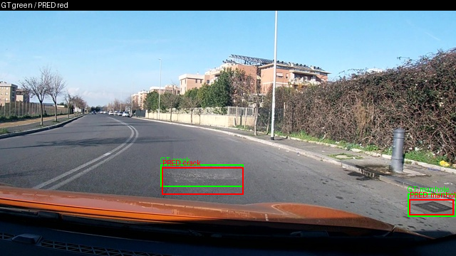
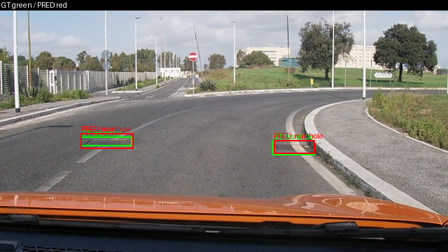
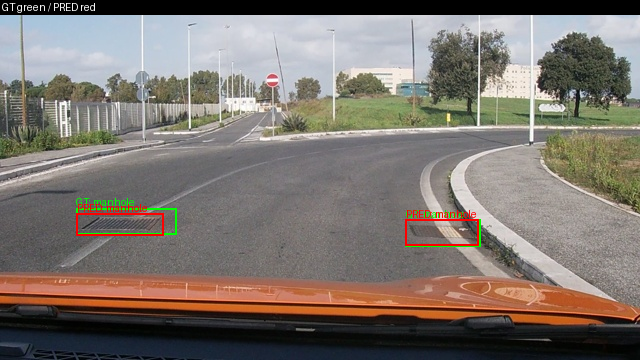
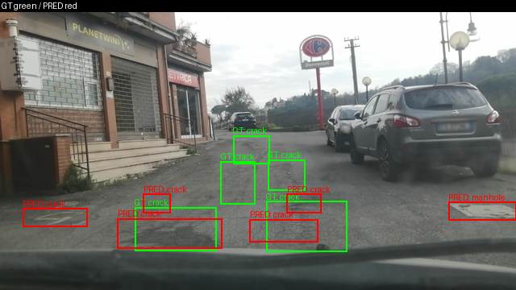
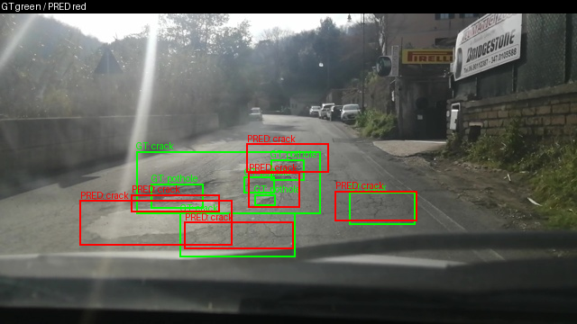
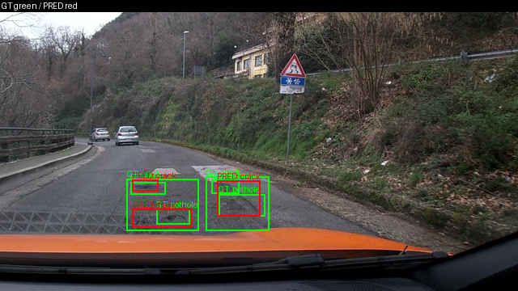
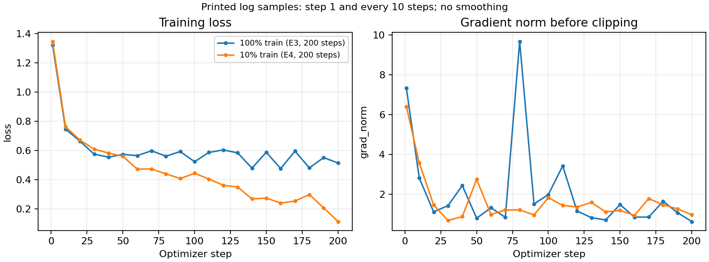

Họ tên: Phan Trọng Hoàn
`dataset_version`: `d10-21e4070301`

## Phạm vi và giới hạn thực nghiệm

E0 là model gốc; E1/E2 khởi tạo độc lập từ model gốc và train đủ 300 bước. E3 cũng khởi tạo độc lập, nhưng chỉ dùng checkpoint **200 bước**: lỗi sao lưu Google Drive làm process dừng sau khi đã lưu checkpoint local. Checkpoint này đã được cứu và kiểm tra ZIP trên Drive. Không gọi E3 là run đủ 300 bước; đây là sai khác so với cấu hình bắt buộc và có thể ảnh hưởng điểm.

E1/E2 dùng AMP scale mặc định 65536; E3 dùng init_scale=1024 sau khi gradient không hữu hạn ở bước 6 với scale mặc định. Thử batch 1/accum 8 cũng lỗi gradient, nên run E3 được giữ lại dùng batch 2/accum 4 như đề. Smoke 8 bước kiểm tra adapter và projector round-trip đều đạt. Vì số bước và scale khác nhau, so sánh E2/E3 chưa cô lập hoàn toàn tác động của LoRA ViT.

E4 đã hoàn thành cả hai giá trị data_size 10%/100% tại 200 bước thực tế. E5 không thực hiện. Bảng dưới là **test**, không trộn với val. Evidence giữ nguyên nội dung scorer gốc.

## Bảng tổng hợp test (311 ảnh)

| Mã | Setup / bước thực tế | Tham số huấn luyện | VRAM đỉnh (GB) | Phút | F1 | CI95 | FP/ảnh | F1 pothole | F1 crack | F1 manhole |
|---|---|---|---|---|---|---|---|---|---|---|
| E0 | zero-shot / 0 | 0 | Không đo | Không train | 0.050901 | [0.032895, 0.071279] | 1.080386 | 0.101911 | 0.000000 | 0.107383 |
| E1 | LoRA LLM / 300 | 33,030,144 | 6.428408 | 44.680388 | 0.260398 | [0.224799, 0.299552] | 1.218650 | 0.147783 | 0.196018 | 0.520000 |
| E2 | + projector / 300 | 142,135,296 | 8.122632 | 45.796419 | 0.329390 | [0.291174, 0.371917] | 1.077170 | 0.184332 | 0.268212 | 0.575540 |
| E3 | + LoRA ViT / **200** | 148,426,752 | 8.302096 | 39.356097 | 0.369818 | [0.331691, 0.410175] | 1.286174 | 0.241667 | 0.299559 | 0.645614 |
| E4 10% | Nền E3 / 200 | 148,426,752 | 7.750809 | 39.230916 | 0.250980 | [0.216511, 0.287356] | 1.710611 | 0.120690 | 0.217523 | 0.505660 |
| E4 100% | Tái sử dụng E3 / 200 | 148,426,752 | 8.302096 | 39.356097 | 0.369818 | [0.331691, 0.410175] | 1.286174 | 0.241667 | 0.299559 | 0.645614 |

Nguồn: [E0](report/evidence/e0.json), [E1](report/evidence/e1.json), [E2](report/evidence/e2.json), [E3 200 bước](report/evidence/e3.json), [E4 10%](report/evidence/e4_data_size_0.1.json), [E4 100%](report/evidence/e4_data_size_1.0.json). Các số trong bảng được làm tròn; JSON chứa giá trị đầy đủ. `train_minutes` là thời gian theo bộ đếm của code, có thể bao gồm các lần backup trước đó; không phải phép đo thời gian GPU thuần túy.

Val dùng gỡ lỗi và chọn nền E4: E1 F1=0.207245; E2=0.300172; E3 200 bước=0.322374. Các file gốc được lưu tại [report/validation](report/validation). Chọn nền E3 theo val trước khi xem kết quả E4; không chọn bằng test.

## 10 câu hỏi

### Câu 1 — Kiến trúc: ViT, projector và LLM có bao nhiêu tham số, E1/E2/E3 cập nhật khối nào?

Luồng xử lý là ViT trích đặc trưng ảnh → merger và các DeepStack merger đưa đặc trưng vào không gian ngôn ngữ → LLM sinh JSON. Quy mô khoảng 4.44B tổng, LLM + embedding khoảng 4.0B và ViT khoảng 415M là **ước lượng kiến trúc trong GUIDE**, không phải phép đếm toàn model mới đo của tôi. Tôi chưa lưu phép đếm riêng từng khối của base model nên không trình bày các ước lượng này như số thực đo.

Số trainable thực đo của tôi: E1=33,030,144; E2=142,135,296; E3=148,426,752. E2 mở thêm đúng 109,105,152 tham số projector; E3 thêm 6,291,456 tham số LoRA ViT so với E2. E1 chỉ LoRA LLM (252 module), E2 thêm full projector `visual.merger` và `visual.deepstack_merger_list`; E3 thêm 96 module attention/MLP ViT, tổng 348 module LoRA. Backbone và lm_head còn lại đóng băng.

### Câu 2 — E0: parse_valid_rate và các lỗi quan sát được?

E0 test có parse_valid_rate=0.401929, tức 125/311 output hợp lệ và 186 output không hợp lệ; missing_predictions=0. F1=0.050901. Trong smoke val đã lưu ở notebook, tôi thấy (1) lặp một box rất nhiều lần, (2) chuỗi bị cắt trước khi đóng JSON. Ví dụ box `{"label":"crack","bbox_2d":[0,370,1000,700]}` lặp lại; phần cuối dừng tại `"bbox_2d": [0, 370, 1000, 700`. Giới hạn sinh của cấu hình là 256 token. Chưa thống kê tần suất từng nguyên nhân trên toàn test, nên không khẳng định thứ hạng phổ biến từ hai mẫu smoke.

E1 test đạt parse_valid_rate=1.0; cải thiện định dạng là rõ, nhưng JSON hợp lệ chưa có nghĩa box đúng.

### Câu 3 — Thang 0–1000: sai thang làm F1 thay đổi thế nào?

Nhãn gốc YOLO chuẩn hóa được đổi sang góc xyxy, nhân 1000, làm tròn/kẹp và sắp theo (y1,x1). Ví dụ box tâm (0.5,0.5), kích thước (0.2,0.2) thành [400,400,600,600], tương ứng pixel [256,144,384,216] trên ảnh 640×360. Đây là kiểm tra tổng hợp nhỏ, không phải kết quả model.

Nếu coi tọa độ 0–1000 là pixel, scorer chia sai theo width/height rồi nhân 1000, làm vị trí/kích thước box và IoU sai dù JSON vẫn hợp lệ. Trên cùng prediction thật E3 của 311 ảnh test, F1 đúng norm1000=0.3698175788, còn cố ý chấm như pixel thì F1=0.0, trong khi parse_valid_rate vẫn 1.0. Đây là phép chấm lại đầu ra đã lưu để phân tích lỗi, không sinh prediction mới, không chọn cấu hình theo test. Kết quả: [coord_scale_check.json](report/analysis/coord_scale_check.json).

### Câu 4 — Vì sao chỉ tính loss trên phần trả lời?

Prompt và ảnh là điều kiện, JSON là đích cần học. Code kiểm tra token prompt là tiền tố của chuỗi user+assistant, đặt labels prompt/ảnh và padding thành -100, giữ phần đáp án và token kết thúc. Ở smoke đã chạy, ảnh 640×360 có 220 token ảnh; ví dụ đầu có 250 token được giám sát và decode đúng JSON nhãn cộng `<|im_end|>\n`.

Nếu tính loss cả prompt/ảnh, mục tiêu bị trộn với việc tái tạo đầu vào; nhiều token không thuộc đáp án chi phối gradient và loss không còn đo riêng khả năng định vị/sinh JSON. Tôi đã kiểm tra mask/padding bằng tensor nhỏ và kiểm tra decode với processor thật; chưa chạy ablation unmasked nên không gán một mức giảm F1 cụ thể.

### Câu 5 — Vì sao projector không được lượng tử hóa, vì sao dùng float32?

QLoRA giữ base 4-bit đóng băng và học phần adapter; E2/E3 yêu cầu cập nhật đầy đủ projector nên projector phải là tham số thực có gradient. Khi tải model, danh sách skip ban đầu dùng `visual` không khớp tên đầy đủ trong Transformers 5.19.0; assertion phát hiện ViT bị lượng tử hóa. Tôi đổi sang `model.visual` và `lm_head`, xác nhận LLM vẫn 4-bit còn ViT/lm_head không bị lượng tử hóa.

Projector train ở fp32 để lưu tham số/gradient với độ chính xác cao hơn và dùng GradScaler, còn forward chạy trong autocast fp16. Việc này không loại bỏ mọi nguy cơ overflow ở các phép toán fp16: E3 vẫn lỗi gradient với scale mặc định, sau đó smoke scale1024 đạt. Checkpoint E2/E3 lưu/nạp riêng projector cùng adapter; round-trip tensor được kiểm tra trước train đầy đủ.

### Câu 6 — Split theo phiên quay và số ảnh/box?

Frame cùng video có thể gần trùng nhau; random split sẽ đưa cảnh tương tự vào cả train/test và làm phép đo lạc quan. Script gốc chia theo session; cell kiểm tra đã xác nhận session và image_id không giao nhau. Không thực hiện random-split ablation nên không báo mức tăng F1 giả.

| Split | Ảnh | pothole | crack | manhole |
|---|---|---|---|---|
| train | 1422 | 1074 | 1750 | 691 |
| val | 276 | 66 | 470 | 103 |
| test | 311 | 121 | 299 | 163 |

Dataset_version=d10-21e4070301; số liệu khớp meta của dataset thật. Val có ít pothole, nên không dùng F1 một lớp trên val để kết luận quá chắc.

### Câu 7 — Mở projector và LoRA ViT có đáng không?

E1 tăng F1 test 0.209496 so E0, vượt ngưỡng 0.10 của rubric. E2 tăng 0.068993 so E1, đồng thời FP/ảnh giảm từ 1.218650 xuống 1.077170; đổi lại thêm 109,105,152 tham số và khoảng 1.694 GB VRAM. Thời gian thực đo E2 hơn E1 khoảng 1.116 phút, nhưng phép đo có I/O backup nên không suy ra tỷ lệ tốc độ thuần.

E3 200 bước có F1 cao nhất quan sát được (0.369818), tăng 0.040427 so E2; F1 cả ba lớp cao hơn. Tuy nhiên FP/ảnh tăng lên 1.286174, còn số bước/scale không đồng nhất với E2. Tôi không kết luận chênh lệch chỉ do LoRA ViT, cũng không dùng thời gian 200 bước để nói E3 nhanh hơn run 300 bước. E2 là đối chứng đủ 300 bước rõ hơn; nền E4 được chọn theo tiêu chí F1 val đã nêu, với giới hạn 200 bước được ghi nhận.

### Câu 8 — Test 311 ảnh và CI95 giới hạn kết luận thế nào?

CI95 F1 E1=[0.224799,0.299552], E2=[0.291174,0.371917], E3=[0.331691,0.410175]; độ rộng khoảng 0.07475, 0.08074 và 0.07848. E1/E2 và E2/E3 đều có vùng giao nhau. Tôi chỉ báo chênh lệch điểm quan sát, chưa khẳng định ý nghĩa thống kê; cần bootstrap ghép cặp của hiệu F1 hoặc thêm session/seed để kiểm tra chắc hơn. CI giao nhau tự nó cũng không chứng minh hai model tương đương.

Scorer gốc bootstrap theo ảnh; vì frame trong cùng session còn tương quan, CI này chưa phản ánh đầy đủ bất định theo session. Chỉ một seed và E3 ít bước hơn là các giới hạn bổ sung. Không điều chỉnh cấu hình theo kết quả test.

### Câu 9 — Phân tích lỗi theo lớp và hình minh họa?

Pothole có F1 thấp nhất ở cả E1/E2/E3. E3 test: pothole TP=29, FP=90, FN=92, F1=0.241667; crack TP=102, FP=280, FN=197, F1=0.299559; manhole TP=92, FP=30, FN=71, F1=0.645614. Crack có số FP lớn nhất, cho thấy còn nhiều dự đoán thừa hoặc định vị chưa đạt IoU0.5.

Box nhỏ, tương phản thấp và sự khác biệt hình dạng có thể là nguyên nhân, nhưng đây là giả thuyết cần đối chiếu ảnh, chưa có thống kê nguyên nhân theo kích thước. Sáu ảnh dưới được chọn từ prediction E3 thật: ba ảnh khớp đủ box và ba ảnh có FP/FN; không đại diện cho tỷ lệ lỗi toàn tập. Ghép box cùng lớp, IoU≥0.5 bằng scorer gốc. GT xanh, prediction đỏ; [manifest](report/analysis/figure_manifest.json) ghi image_id và số đếm để đối chiếu.

`vlcsnap-00200`: TP=2, FP=0, FN=0; khớp đủ hai box.

`vlcsnap-2025-02-18-23h13m52s540`: TP=2, FP=0, FN=0; không có box thừa/bỏ sót ở ngưỡng chấm.

`vlcsnap-2025-02-18-23h13m55s630`: TP=2, FP=0, FN=0; khớp đủ box.

`vlcsnap-2025-02-18-23h24m36s429`: TP=1, FP=5, FN=4; nhiều box không ghép được, vừa dự đoán thừa vừa bỏ sót.

`vlcsnap-2025-02-18-23h30m28s990`: TP=2, FP=4, FN=5; có box đúng nhưng vẫn bỏ sót phần lớn GT.

`vlcsnap-2025-02-19-17h03m02s980`: TP=0, FP=3, FN=6; JSON hợp lệ nhưng không có box đạt ghép lớp/IoU.

### Câu 10 — E4 đổi biến nào và kết luận?

Chỉ đổi train_fraction: 10% so với 100%, nền E3 đã chọn bằng val. Subset train cố định seed42 gồm floor(1422×0.1)=142 ảnh, không thay val/test. Cả hai dùng batch2/accum4, scale1024, LR=2e-4, rank16/alpha32/dropout0.05 và cùng 200 bước thực tế. Lịch LR vẫn dùng horizon300 để khớp 200 bước đầu của E3 đối chứng; không đổi horizon thành 200.

Đối chứng 100% tái sử dụng prediction/checkpoint E3 200 bước. Run 10% khởi tạo từ model gốc, không train tiếp adapter E3. E4 cũng chưa đủ 300 bước như đề; đây là phương án có ghi nhận sát hạn, không tự nhận đạt đầy đủ rubric.

10% đạt F1=0.250980, CI95=[0.216511,0.287356]; 100% đạt F1=0.369818, CI95=[0.331691,0.410175]. Giảm dữ liệu làm F1 giảm 0.118837 và FP/ảnh tăng từ 1.286174 lên 1.710611; cả ba lớp đều giảm F1, trong khi JSON hợp lệ vẫn 100%. Các CI không giao nhau, phù hợp với mức giảm rõ ở lần chạy này, nhưng chưa có bootstrap hiệu ghép cặp hoặc nhiều seed để khẳng định tổng quát. Cùng 200 bước mà chỉ 142 ảnh train khiến mẫu bị lặp nhiều hơn; loss train cuối 0.114054 không đồng nghĩa tổng quát hóa tốt. So sánh E4 cô lập fraction ở cùng lịch/budget thực tế; không đại diện cho kết quả đủ 300 bước của đề.

#### Nhật ký train bổ sung từ notebook Colab v2

Biểu đồ dùng đúng 21 điểm đã in cho mỗi run (bước 1, 10, 20, …, 200), không nội suy thành log đầy đủ và không làm trơn. E3 loss từ 1.322907 xuống 0.514528; E4 10% từ 1.346753 xuống 0.114054. Tất cả điểm gradient đã trích đều hữu hạn, scale=1024. Loss E4 thấp hơn nhưng F1 test thấp hơn, phù hợp với nguy cơ học lặp tập nhỏ; chưa đủ để tách mọi nguyên nhân của chênh lệch tổng quát hóa.

Nguồn: [log trích nguyên văn](report/logs/colab_v2_excerpt.txt), [các điểm train có provenance](report/logs/sampled_training_events.json). Bản v2 xác nhận E3 dừng do lỗi backup ở bước 200; E4 hoàn thành bước 200 dù backup cuối lỗi. Log bổ sung sau lần push nộp đầu tiên, không thay evidence hay khẳng định đã có run300.

## Nhìn lại

Đã có evidence thật E0–E4, sáu ảnh có chú thích và kiểm chứng sai thang; E1 đạt yêu cầu định dạng/cải thiện F1. Vấn đề chính khi triển khai: tên skip quantization đầy đủ, torchao tùy chọn không tương thích, overflow gradient fp16 ở E3 và lỗi backup Drive. Đã sửa backup để lỗi Drive không làm dừng train; E4 đủ 200 bước dù backup bước cuối lỗi. Bản checkpoint tại thời điểm lỗi E3 chưa lưu optimizer/RNG để resume chính xác.

Giới hạn chính của bài nộp là E3/E4 chỉ 200 bước, E3 đổi AMP scale so với E1/E2, một seed, CI bootstrap theo ảnh và chưa đếm riêng toàn bộ tham số kiến trúc trên base model. Không coi checkpoint 200 bước là đủ 300. Test mẫu REPORT của đề còn yêu cầu marker chưa điền, trái với checker của báo cáo hoàn chỉnh; ghi nhận lỗi này, không sửa test gốc hoặc chèn marker giả để lách kiểm tra.
