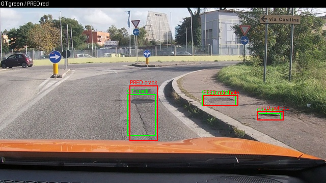
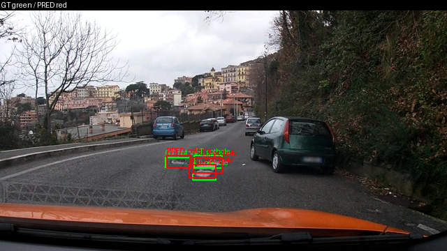
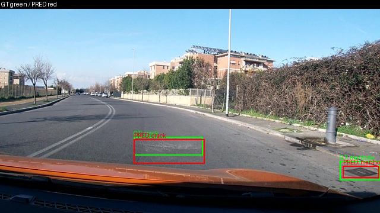
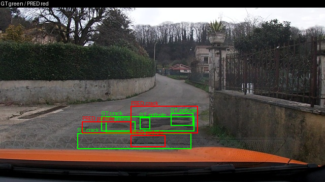
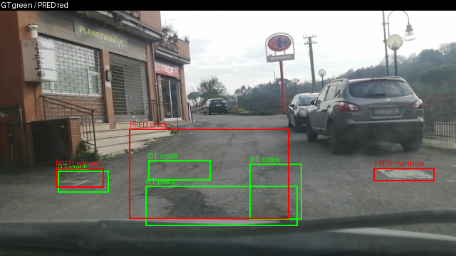
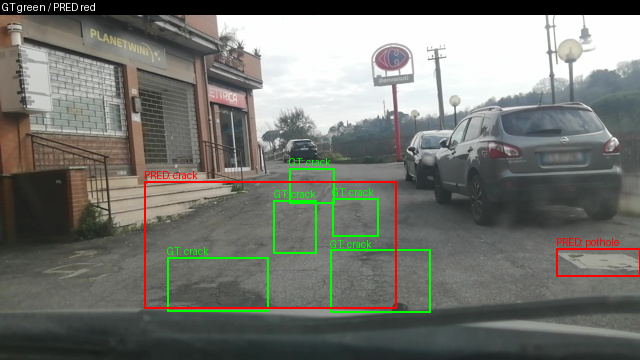

Họ tên: Phan Trọng Hoàn
`dataset_version`: `d10-21e4070301`

## Phạm vi và giới hạn thực nghiệm

E0 là model gốc; E1/E2/E3 khởi tạo độc lập từ model gốc và đều train đủ **300 bước**. E3 mới là run `e3_r300_v1`, đã resume bằng optimizer/scheduler/scaler/RNG và thứ tự batch từ checkpoint 200 rồi 220. E4 10% là run `e4_data10_r300_v2_e3`, khởi tạo từ model gốc, đủ 300 bước; đối chứng 100% tái sử dụng E3. E5 không thực hiện.

E1/E2 dùng AMP scale mặc định 65536; E3/E4 dùng init_scale 1024 sau lỗi gradient fp16. E3 từng dừng ở 216 dù loss hữu hạn; code mới retry có giới hạn, phát lại batch/RNG và giảm scale khi gradient không hữu hạn, không cập nhật optimizer/LR cho lần thử lỗi. Log thành công không chứng minh retry đã được kích hoạt ở 216; không tự nhận overflow đã tái hiện. Scale khác nhau vẫn là giới hạn khi diễn giải E2/E3.

Run E4 v1 đủ 300 từng báo backup thành công nhưng ZIP Drive trở thành 0 byte ở phiên sau. Không dùng metadata thay trọng số: E4 được train lại độc lập thành v2 và chấm test thật. ZIP rescue v2 đã được người dùng sao chép, kiểm tra kích thước/SHA256 và cấu trúc ZIP trong phiên; chưa coi đó là bảo đảm lưu trữ lâu dài. `model_revision=null` là thiếu provenance phiên bản model. [Bản báo cáo 200 bước](https://github.com/naoh-pt/K4-Track-4-Day10-VisionLanguageModel/blob/9e211e9/REPORT.md) và evidence cũ được giữ riêng, không trộn với bảng mới.

## Bảng tổng hợp test (311 ảnh)

| Mã | Setup / bước thực tế | Tham số huấn luyện | VRAM đỉnh (GB) | Phút | F1 | CI95 | FP/ảnh | F1 pothole | F1 crack | F1 manhole |
|---|---|---|---|---|---|---|---|---|---|---|
| E0 | zero-shot / 0 | 0 | Không đo | Không train | 0.050901 | [0.032895, 0.071279] | 1.080386 | 0.101911 | 0.000000 | 0.107383 |
| E1 | LoRA LLM / 300 | 33,030,144 | 6.428408 | 44.680388 | 0.260398 | [0.224799, 0.299552] | 1.218650 | 0.147783 | 0.196018 | 0.520000 |
| E2 | + projector / 300 | 142,135,296 | 8.122632 | 45.796419 | 0.329390 | [0.291174, 0.371917] | 1.077170 | 0.184332 | 0.268212 | 0.575540 |
| E3 | + LoRA ViT / 300 | 148,426,752 | 8.302537 | 58.053650 | 0.433515 | [0.395126, 0.475915] | 0.890675 | 0.294643 | 0.355786 | 0.691525 |
| E4 10% | Nền E3 / 300, v2 | 148,426,752 | 7.750031 | 58.903531 | 0.302795 | [0.268997, 0.337255] | 1.639871 | 0.207612 | 0.225627 | 0.597865 |
| E4 100% | Tái sử dụng E3 / 300 | 148,426,752 | 8.302537 | 58.053650 | 0.433515 | [0.395126, 0.475915] | 0.890675 | 0.294643 | 0.355786 | 0.691525 |

Nguồn: [E0](report/evidence/e0.json), [E1](report/evidence/e1.json), [E2](report/evidence/e2.json), [E3 300 bước](report/evidence/e3.json), [E4 10%](report/evidence/e4_data_size_0.1.json), [E4 100%](report/evidence/e4_data_size_1.0.json). Các số trong bảng được làm tròn; JSON chứa giá trị đầy đủ. `train_minutes` là thời gian theo bộ đếm của code, có thể bao gồm các lần backup trước đó; không phải phép đo thời gian GPU thuần túy. Với resume, bộ đếm không cộng toàn bộ thời gian của phiên thất bại/các bước phải chạy lại; E4 v2 không cộng chi phí run v1 bị mất backup.

Val dùng gỡ lỗi và chọn nền E4: E1 F1=0.207245; E2=0.300172; E3 300 bước=0.362140. Các file gốc được lưu tại [report/validation](report/validation). Chọn nền E3 theo val trước khi xem kết quả E4; không chọn bằng test.

## 10 câu hỏi

### Câu 1 — Kiến trúc: ViT, projector và LLM có bao nhiêu tham số, E1/E2/E3 cập nhật khối nào?

Luồng xử lý là ViT trích đặc trưng ảnh → merger và các DeepStack merger đưa đặc trưng vào không gian ngôn ngữ → LLM sinh JSON. [Phép đếm thực tế trên Colab](report/analysis/architecture.json) cho tổng 4,437,815,808 tham số duy nhất: backbone ViT 306,242,560; merger 27,271,680; DeepStack mergers 81,833,472; language_model 4,022,468,096. Projector tổng 109,105,152; toàn visual 415,347,712. Params4bit được đếm bằng shape gốc trước khi pack uint8. `lm_head:0` là số tham số riêng được gán vào nhóm này khi loại bỏ tham số dùng chung, không phải chứng cứ rằng model không có head; chưa ghi kiểm chứng alias riêng.

Số trainable thực đo của tôi: E1=33,030,144; E2=142,135,296; E3=148,426,752. E2 mở thêm đúng 109,105,152 tham số projector; E3 thêm 6,291,456 tham số LoRA ViT so với E2. E1 chỉ LoRA LLM (252 module), E2 thêm full projector `visual.merger` và `visual.deepstack_merger_list`; E3 thêm 96 module attention/MLP ViT, tổng 348 module LoRA. Backbone và lm_head còn lại đóng băng.

### Câu 2 — E0: parse_valid_rate và các lỗi quan sát được?

E0 test có parse_valid_rate=0.401929, tức 125/311 output hợp lệ và 186 output không hợp lệ; missing_predictions=0. F1=0.050901. Trong output smoke val của phiên Colab trước, tôi quan sát (1) lặp một box rất nhiều lần, (2) chuỗi bị cắt trước khi đóng JSON. Ví dụ box `{"label":"crack","bbox_2d":[0,370,1000,700]}` lặp lại; phần cuối dừng tại `"bbox_2d": [0, 370, 1000, 700`. Giới hạn sinh của cấu hình là 256 token. Chưa thống kê tần suất từng nguyên nhân trên toàn test, nên không khẳng định thứ hạng phổ biến từ hai mẫu smoke.

E1 test đạt parse_valid_rate=1.0; cải thiện định dạng là rõ, nhưng JSON hợp lệ chưa có nghĩa box đúng.

### Câu 3 — Thang 0–1000: sai thang làm F1 thay đổi thế nào?

Nhãn gốc YOLO chuẩn hóa được đổi sang góc xyxy, nhân 1000, làm tròn/kẹp và sắp theo (y1,x1). Ví dụ box tâm (0.5,0.5), kích thước (0.2,0.2) thành [400,400,600,600], tương ứng pixel [256,144,384,216] trên ảnh 640×360. Đây là kiểm tra tổng hợp nhỏ, không phải kết quả model.

Nếu coi tọa độ 0–1000 là pixel, scorer chia sai theo width/height rồi nhân 1000, làm vị trí/kích thước box và IoU sai dù JSON vẫn hợp lệ. Trên cùng prediction thật **E3 300 bước** của 311 ảnh test, F1 đúng norm 1000=0.4335154827, còn cố ý chấm như pixel thì F1=0.0, trong khi parse_valid_rate vẫn 0.993569. Đây là phép chấm lại đầu ra đã lưu để phân tích lỗi, không sinh prediction mới, không chọn cấu hình theo test. Kết quả: [coord_scale_check.json](report/analysis/coord_scale_check.json).

### Câu 4 — Vì sao chỉ tính loss trên phần trả lời?

Prompt và ảnh là điều kiện, JSON là đích cần học. Code kiểm tra token prompt là tiền tố của chuỗi user+assistant, đặt labels prompt/ảnh và padding thành -100, giữ phần đáp án và token kết thúc. Ở smoke đã chạy, ảnh 640×360 có 220 token ảnh; ví dụ đầu có 250 token được giám sát và decode đúng JSON nhãn cộng `<|im_end|>\n`.

Nếu tính loss cả prompt/ảnh, mục tiêu bị trộn với việc tái tạo đầu vào; nhiều token không thuộc đáp án chi phối gradient và loss không còn đo riêng khả năng định vị/sinh JSON. Tôi đã kiểm tra mask/padding bằng tensor nhỏ và kiểm tra decode với processor thật; chưa chạy ablation unmasked nên không gán một mức giảm F1 cụ thể.

### Câu 5 — Vì sao projector không được lượng tử hóa, vì sao dùng float32?

QLoRA giữ base 4-bit đóng băng và học phần adapter; E2/E3 yêu cầu cập nhật đầy đủ projector nên projector phải là tham số thực có gradient. Khi tải model, danh sách skip ban đầu dùng `visual` không khớp tên đầy đủ trong Transformers 5.19.0; assertion phát hiện ViT bị lượng tử hóa. Tôi đổi sang `model.visual` và `lm_head`, xác nhận LLM vẫn 4-bit còn ViT/lm_head không bị lượng tử hóa.

Projector train ở fp32 để lưu tham số/gradient với độ chính xác cao hơn và dùng GradScaler, còn forward chạy trong autocast fp16. Việc này không loại bỏ mọi nguy cơ overflow ở các phép toán fp16: E3 vẫn lỗi gradient với scale mặc định, sau đó smoke scale 1024 đạt. Checkpoint E2/E3 lưu/nạp riêng projector cùng adapter; round-trip tensor được kiểm tra trước train đầy đủ.

### Câu 6 — Split theo phiên quay và số ảnh/box?

Frame cùng video có thể gần trùng nhau; random split sẽ đưa cảnh tương tự vào cả train/test và làm phép đo lạc quan. Script gốc chia theo session; cell kiểm tra đã xác nhận session và image_id không giao nhau. Không thực hiện random-split ablation nên không báo mức tăng F1 giả.

| Split | Ảnh | pothole | crack | manhole |
|---|---|---|---|---|
| train | 1422 | 1074 | 1750 | 691 |
| val | 276 | 66 | 470 | 103 |
| test | 311 | 121 | 299 | 163 |

Dataset_version=d10-21e4070301; số liệu khớp meta của dataset thật. Val có ít pothole, nên không dùng F1 một lớp trên val để kết luận quá chắc.

### Câu 7 — Mở projector và LoRA ViT có đáng không?

E1 tăng F1 test 0.209496 so E0, vượt ngưỡng 0.10 của rubric. E2 tăng 0.068993 so E1, đồng thời FP/ảnh giảm từ 1.218650 xuống 1.077170; đổi lại thêm 109,105,152 tham số và khoảng 1.694 GB VRAM. Thời gian thực đo E2 hơn E1 khoảng 1.116 phút, nhưng phép đo có I/O backup nên không suy ra tỷ lệ tốc độ thuần.

E3 đủ 300 có F1 cao nhất quan sát được 0.433515, tăng 0.104125 so E2. FP/ảnh giảm từ 1.077170 xuống 0.890675, F1 cả ba lớp cao hơn. Mở LoRA ViT thêm 6,291,456 tham số, VRAM tăng khoảng0.180GB. Số bước và lịch LR đã đồng nhất 300; tuy nhiên AMP scale khác và chỉ một seed nên không quy toàn bộ chênh lệch cho LoRA ViT. E3 được chọn làm nền E4 bằng F1 val 0.362140, không phải bằng test.

### Câu 8 — Test 311 ảnh và CI95 giới hạn kết luận thế nào?

CI95 F1 E1=[0.224799,0.299552], E2=[0.291174,0.371917], E3=[0.395126,0.475915]. E1/E2 có vùng giao; E2/E3 không giao trong lần chạy này. Tôi chỉ báo chênh lệch điểm quan sát; chưa có bootstrap ghép cặp của hiệu F1 hoặc nhiều seed để kiểm tra ý nghĩa thống kê. CI giao/không giao không thay thế trực tiếp kiểm định hiệu ghép cặp.

Scorer gốc bootstrap theo ảnh; vì frame trong cùng session còn tương quan, CI này chưa phản ánh đầy đủ bất định theo session. Chỉ một seed, AMP scale khác nhau và thiếu model revision là các giới hạn bổ sung. Không điều chỉnh cấu hình theo kết quả test.

### Câu 9 — Phân tích lỗi theo lớp và hình minh họa?

Pothole có F1 thấp nhất ở cả E1/E2/E3. E3 300 bước test: pothole TP=33, FP=70, FN=88, F1=0.294643; crack TP=103, FP=177, FN=196, F1=0.355786; manhole TP=102, FP=30, FN=61, F1=0.691525. Crack có nhiều FP nhất, cho thấy dự đoán thừa hoặc định vị chưa đạt IoU 0.5 vẫn là vấn đề.

Box nhỏ, tương phản thấp và sự khác biệt hình dạng có thể là nguyên nhân, nhưng chưa có thống kê lỗi theo kích thước. Sáu hình sau được xuất từ prediction E3 **300 bước**: ba ảnh khớp đủ box và ba ảnh có nhiều FP/FN. Chọn mẫu theo số ghép box cùng lớp, IoU≥0.5 của scorer gốc, không đại diện tỷ lệ lỗi toàn tập. GT xanh, prediction đỏ; [manifest](report/analysis/figure_manifest.json) ghi nguồn và số đếm.

`vlcsnap-2025-02-18-23h10m48s405`: TP=3, FP=0, FN=0; khớp đủ box.

`vlcsnap-2025-02-19-17h04m47s362`: TP=3, FP=0, FN=0; khớp đủ box.

`vlcsnap-00200`: TP=2, FP=0, FN=0; khớp đủ box.

`vlcsnap-2025-02-19-17h08m59s876`: TP=0, FP=3, FN=5; có box thừa hoặc bỏ sót; JSON hợp lệ không bảo đảm định vị đúng.

`vlcsnap-2025-02-18-23h24m34s484`: TP=0, FP=3, FN=4; có box thừa hoặc bỏ sót; JSON hợp lệ không bảo đảm định vị đúng.

`vlcsnap-2025-02-18-23h24m36s429`: TP=0, FP=2, FN=5; có box thừa hoặc bỏ sót; JSON hợp lệ không bảo đảm định vị đúng.

### Câu 10 — E4 đổi biến nào và kết luận?

Chỉ đổi train_fraction: 10% so với 100%, nền E3 đã chọn bằng val. Subset seed 42 gồm floor(1422×0.1)=142 ảnh, không thay val/test. Hai nhánh cùng batch 2/accum 4, init_scale 1024, LR 2e-4, rank 16/alpha 32/dropout 0.05 và **300 optimizer steps, horizon 300**. Run 10% khởi tạo từ model gốc; đối chứng 100% tái sử dụng prediction/checkpoint E3 đủ 300, không fine-tune tiếp adapter E3. Cả hai dùng bản code có retry AMP cho phần train mới; đây là chính sách xử lý số học có ghi nhận.

10% đạt F1=0.302795, CI95=[0.268997,0.337255]; 100% đạt F1=0.433515, CI95=[0.395126,0.475915]. Giảm dữ liệu làm F1 giảm 0.130720 và FP/ảnh tăng từ 0.890675 lên 1.639871. Cả ba lớp giảm F1; JSON hợp lệ 10% = 100%, 100% = 99.3569%, cho thấy định dạng tốt không đồng nghĩa định vị tốt. CI không giao nhưng chưa có bootstrap hiệu ghép cặp/multiple seeds. Cùng số bước trên 142 ảnh làm lặp mẫu nhiều hơn; không suy ra loss thấp đồng nghĩa tổng quát hóa tốt. Kết luận chỉ cho subset/seed/budget đã chạy.

## Nhìn lại

Đã có evidence thật E0–E4; E1/E2/E3 và hai nhánh E4 đủ 300 bước. Vấn đề triển khai gồm skip quantization đầy đủ, torchao không tương thích, gradient fp16 không hữu hạn và backup Drive mất dữ liệu dù kiểm tra cùng phiên từng thành công. Đã bổ sung checkpoint optimizer/RNG/batch cursor và retry gradient có giới hạn, kiểm tra bằng fixture CPU rồi người dùng chạy T4 thực tế. Không cam kết ZIP Drive bền vững chỉ từ xác minh trong một phiên.

Giới hạn còn lại: một seed, AMP scale E1/E2 khác E3/E4, thiếu model revision và CI bootstrap theo ảnh. Hình minh họa và kiểm chứng sai thang dùng prediction 300. E5 chưa làm. Test mẫu REPORT yêu cầu marker chưa điền trái với checker báo cáo hoàn chỉnh; không sửa test gốc hoặc chèn marker giả. Kết quả kiểm tra hiện hành ghi ở [verification.json](report/analysis/verification.json).
